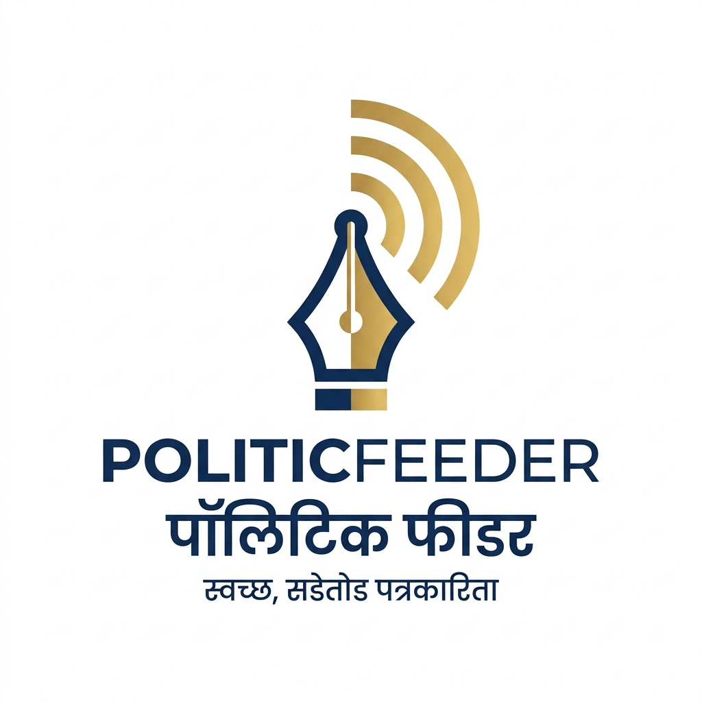

# 📰 PoliticFeeder (पॉलिटिकफीडर)
> **महाराष्ट्राचा निर्भीड, सडेतोड आणि वेगवान मराठी डिजिटल न्यूज प्लॅटफॉर्म**



**PoliticFeeder** हे खास संपूर्ण महाराष्ट्रासाठी डिझाईन केलेले आधुनिक मराठी न्यूज पोर्टल आहे. यात राजकारण (Politics Feeder), महाराष्ट्र विशेष घडामोडी, देश, आंतरराष्ट्रीय, अर्थ व कृषी, क्रीडा आणि मनोरंजनाच्या बातम्या सडेतोड व विश्वासार्ह पद्धतीने वाचकांपर्यंत पोहोचवल्या जातात.

---

## 🌟 प्रमुख वैशिष्ट्ये (Key Features)

### १. वाचक पोर्टल (Public News Portal):
- **रॉयल नेव्ही व डीप ब्लू प्रीमियम थीम (Royal Blue & Navy Theme)**: अत्याधुनिक मीडिया पोर्टल डिझाइन, डार्क व लाइट मोड पर्यायासह.
- **ठळक घडामोडी (Breaking News Ticker)**: थेट अ‍ॅनिमेटेड ब्रेकिंग न्यूज स्क्रोलर (Pause on Hover).
- **लाइव्ह मराठी तारीख, घड्याळ व हवामान**: मुंबई, पुणे, नागपूर आणि नाशिकच्या तापमानासह रिअल-टाइम मराठी अपडेट्स.
- **जिल्हानिहाय फिल्टर (Maharashtra Region Pulse)**: मुंबई, पुणे, नाशिक, नागपूर, छत्रपती संभाजीनगर, कोल्हापूर, विदर्भ, मराठवाडा या जिल्ह्यांनुसार बातम्यांचे त्वरित वर्गीकरण.
- **सविस्तर वाचन कक्ष (Full Article Reader Modal)**:
  - मराठी व्हॉईस रिडर (Text-to-Speech) - बातमी ऐकण्याची सुविधा! 🔊
  - फॉन्ट साइज ॲडजस्टर (अ- लहान / अ मूळ / अ+ मोठे).
  - व्हॉट्सॲप आणि सोशल मीडिया वन-क्लिक शेअरिंग.
  - स्थानिक प्रतिक्रिया (Comments) नोंदवण्याची व पाहण्याची सुविधा.
- **आजचे जनमत (Daily Marathi Opinion Poll)**: सद्य राजकीय विषयांवर थेट मतदान आणि रिअल-टाइम टक्केवारी बार!
- **इन्स्टंट सर्च (Instant Search)**: कोणत्याही बातमी, नेता किंवा शहराचे नाव टाईप करताच त्वरित निकाल.
- **बुकमार्किंग (Save Articles)**: आवडीच्या बातम्या सेव्ह करून नंतर वाचण्याची सुविधा.

### २. अॅडमिन कंट्रोल पॅनेल (Admin Management Panel):
- **थेट डॅशबोर्ड**: एकूण बातम्या, ब्रेकिंग अलर्ट्स, वाचक संख्या (Views) आणि मुख्य बातम्यांची आकडेवारी.
- **नवीन बातमी जोडा (Add Article)**:
  - शीर्षक, वर्गवारी, जिल्हा, लेखक, संक्षिप्त सारांश आणि सविस्तर मजकूर.
  - रेडीमेड हाय-रिझोल्यूशन वृत्त छायाचित्रांची निवड (Preset News Photos).
  - ब्रेकिंग न्यूज, मुख्य लीड स्टोरी किंवा ट्रेंडिंग बातमी म्हणून प्रसिद्ध करण्याचा पर्याय.
- **बातम्यांचे संपूर्ण व्यवस्थापन (Full CRUD)**:
  - बातमी संपादित करा (Edit).
  - डिलीट करा (Delete).
  - ब्रेकिंग स्टेटस एका क्लिकवर चालू/बंद करा (Toggle Breaking).
- **डेटा बॅकअप व रीसेट**: सर्व बातम्यांचा JSON बॅकअप डाऊनलोड करा किंवा मूळ डीफॉल्ट बातम्या रीस्टोअर करा.
- **स्थानिक सुरक्षितता (LocalStorage Persistence)**: कोणतीही बाह्य डेटाबेस गरज नसताना सर्व डेटा ब्राउझरमध्ये कायम राहतो.

---

## 🚀 स्थानिक पातळीवर कसे सुरू करावे? (How to Run Locally)

कोणत्याही अतिरिक्त इन्स्टॉलेशनशिवाय तुम्ही हे पोर्टल थेट चालू करू शकता:

### पर्याय १: थेट ब्राउझरमध्ये
`index.html` फाईलवर डबल-क्लिक करा किंवा कोणत्याही ब्राउझरमध्ये (Chrome, Edge, Firefox) ड्रॅग करून उघडा.

### पर्याय २: लोकल सर्व्हरद्वारे (Recommended)
```bash
# Python द्वारे
python -m http.server 8080

# किंवा Node.js द्वारे
npx serve .
```
त्यानंतर ब्राउझरमध्ये `http://localhost:8080` उघडा.

---

## 🌐 स्वतःचे डोमेन कसे जोडावे? (Custom Domain Setup)

जेव्हा तुम्ही भविष्यात डोमेन खरेदी कराल (उदा. `politicfeeder.in`, `politicfeeder.com`):

### GitHub Pages द्वारे विनामूल्य होस्टिंग:
1. या रेपॉजिटरीच्या **Settings** मध्ये जा.
2. डाव्या बाजूला **Pages** पर्यायावर क्लिक करा.
3. Branch मध्ये `main` निवडून `/root` सेव्ह करा.
4. खाली दिलेल्या **Custom Domain** बॉक्समध्ये तुमचे डोमेन नाव टाईप करा (उदा. `politicfeeder.in`).
5. तुमच्या डोमेन रजिस्ट्रारकडे (GoDaddy, Namecheap, Hostinger) खालील DNS रेकॉर्ड्स जोडा:
   - **Type**: `CNAME` | **Name**: `www` | **Value**: `sahilya-flutter.github.io`
   - **Type**: `A` (Apex domain साठी) GitHub IPs:
     - `185.199.108.153`
     - `185.199.109.153`
     - `185.199.110.153`
     - `185.199.111.153`

---

## 📁 प्रोजेक्ट रचना (Project Structure)

```
politicfeeder/
│
├── index.html          # मुख्य HTML5 वेबपेज (वाचक पोर्टल + अॅडमिन पॅनेल)
├── styles.css          # रॉयल नेव्ही व डीप ब्लू मॉडर्न CSS डिझाइन
├── app.js              # संपूर्ण JavaScript लॉजिक, अॅडमिन फंक्शन्स, व्हॉईस, पोल
├── news-data.js        # प्राथमिक अस्सल मराठी बातम्यांचा डेटाबेस
├── README.md           # माहिती व डोमेन गाईड
└── assets/
    └── logo.jpg        # पॉलिटिकफीडर ब्रँड लोगो
```

---

## 🛡️ संपादकीय आचारसंहिता
PoliticFeeder हे निःपक्षपाती, सत्यवादी आणि निर्भीड पत्रकारितेसाठी वचनबद्ध आहे.
&copy; 2026 PoliticFeeder Network.
